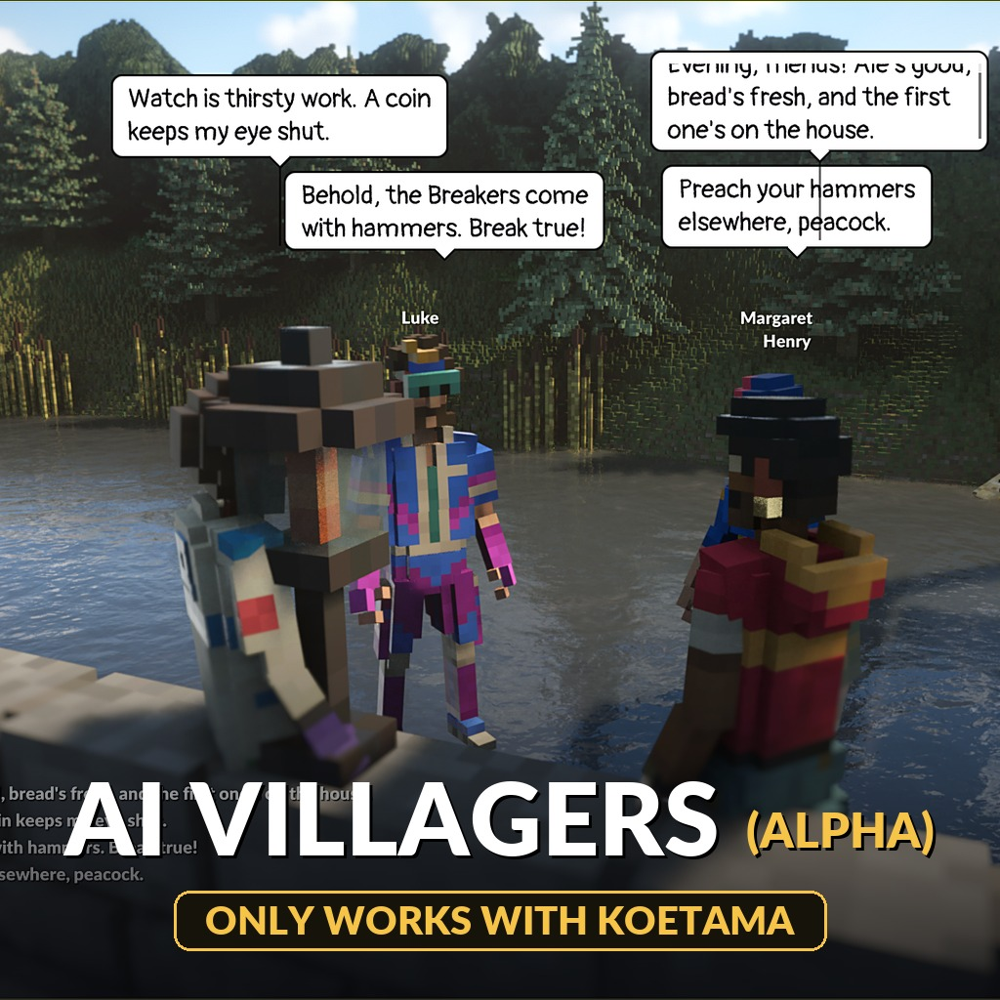

# ⚠ This mod only works with Koetama ⚠

On the Steam Workshop: [AI Villagers (Alpha)](https://steamcommunity.com/sharedfiles/filedetails/?id=3840579200)

**The villagers are AI characters: the host needs the free [Koetama](https://github.com/AgeOfAlgorithms/koetama) app running, with a language model set up (your own API key - DeepSeek, OpenAI, Anthropic, Gemini... - or a local model) and allowed for Teardown, plus the [Proximity Comms](https://steamcommunity.com/sharedfiles/filedetails/?id=3812301496) mod.** Without Koetama the villagers just stand still with "Koetama not detected" over their heads.

# AI Villagers (Alpha)

A small village moves into any map. The villagers find houses and beds on their own, go to work, drink at the tavern, pray at the chapel, gossip, quarrel and sleep at night. Talk to them out loud or in the chat and they answer as themselves: in their own words, in their own mood, and not always nicely. They talk to each other too, even when nobody is watching.

## Twelve villagers
Four live in the village by default: **Betty** the warm baker, **Henry** the gossiping tavern keeper, **Frank** the curt blacksmith and **Victor**, the night watchman who takes bribes. Eight more can move in from the mod's options: the old chapel keeper, the gravedigger who hears the dead under the hill, the reckless apprentice, a money-minded shopkeeper, a preacher of a strange new faith, the reeve, a grumpy shepherd losing sheep, and the herb-woman. Each has a job, a faith, secrets, grudges and goals of their own.

## What they do
- **Live their own lives**: each one decides their day with their own AI - work, meals, the tavern, prayer, visiting or confronting someone - and slacks off if that is their nature. They sleep at night (with the [Day & Night](https://steamcommunity.com/sharedfiles/filedetails/?id=3838065082) mod's clock if you have it).
- **Talk like people**: short, back-and-forth conversations. The one you face or name answers; ask a group and they take turns. Villagers chat with each other with speech bubbles, and know when to leave a conversation.
- **Remember**: what you said, what you did to them, promises, insults and gifts - and they talk about you behind your back. Each night their memories are sorted: the important stays, small talk fades.
- **See, hear and smell** only what they really can: what is in sight, sounds through walls muffled, smoke from a fire. They read your name over your head and notice what you hold and wear - but only care if it's strange.
- **React**: they put out fires with an extinguisher, bandage the wounded, fight back, run, chase, yell or whisper. When something terrible happens, they go quiet and decide what to do.
- **Get hurt**: weapons, bullets, explosions, fire, blowtorches and cars. They bleed, collapse, can be bandaged back up - or die, and their neighbours will remember who did it.

## Works with
- **[Proximity Comms](https://steamcommunity.com/sharedfiles/filedetails/?id=3812301496)** (required): their voices, speech bubbles and babble.
- **[Day & Night & Weather Cycle](https://steamcommunity.com/sharedfiles/filedetails/?id=3838065082)**: their clock and the date they talk about.
- **[McPuppet Inventory System](https://steamcommunity.com/sharedfiles/filedetails/?id=3840357667)**: they see what you wear and hold, and the Inventory's weapons and punches hurt them.
- **Creature mods**: [Lily](https://steamcommunity.com/sharedfiles/filedetails/?id=3837310472), [Dreadweaver](https://steamcommunity.com/sharedfiles/filedetails/?id=3837295009), [Abyssipede](https://steamcommunity.com/sharedfiles/filedetails/?id=3833158470) and [Giant Centipedes](https://steamcommunity.com/sharedfiles/filedetails/?id=3838368186) hunt villagers like players; each villager decides for themselves what they think of every creature they meet (and of [Mochi](https://steamcommunity.com/sharedfiles/filedetails/?id=3826771785) and [Duchess](https://steamcommunity.com/sharedfiles/filedetails/?id=3833506307)).
- **Modders**: an API lets any mod describe its creatures and things to the villagers, tell them news, give them quests, hurt them or read where they are. See [API.md](API.md).

## Options
- **Villagers**: switch each of the twelve on or off (four by default).
- **Village life**: Quiet (they only use the AI when spoken to) to Bustling.
- **Conversation length**: how long villagers talk among themselves.

## Before you play: the AI costs tokens
The villagers think and talk with the language model the **host** chose in Koetama, all the time, even when nobody is near - and the host pays for it. A busy village can use millions of tokens an hour. Fewer villagers, a quieter village life and shorter conversations last much longer; Koetama's monthly limit protects you. When it runs out, the villagers freeze with "Koetama's AI budget ran out" over their heads. What players say near the villagers is sent to that AI service.

## Alpha
This is an early version: villagers can get stuck on unusual maps, say odd things, or misjudge a situation. Bug reports and ideas are very welcome on Discord.

## Community

Join the [Discord community](https://discord.gg/gNpRewdkxf) to post bug reports and suggestions.

## Install

Subscribe on the [Steam Workshop](https://steamcommunity.com/sharedfiles/filedetails/?id=3840579200), or clone this repository into
`Documents/Teardown/mods/villagers`. Enable it under **Global mods** (in multiplayer the host does).

## Credits

Made by AgeOfAlgorithms and Claude (Anthropic). MIT licence.
